Data Engineer en alternance depuis **4 ans** à l'**ARS Nouvelle-Aquitaine**, au Pôle Études et Statistiques, et en **M2 Data Engineering & IA** à l'EFREI Bordeaux.

Je construis les pipelines et les tableaux de bord qui servent au pilotage financier d'environ **150 établissements de santé** de la région. En dehors, je travaille sur des architectures de streaming et des assistants IA qui tournent entièrement en local.

### Stack

### En ce moment

- Microsoft Fabric (DP-700) et sécurité des données, en M2
- Un analyseur de PDF local : OCR, recherche hybride, réponses citées à la page près

